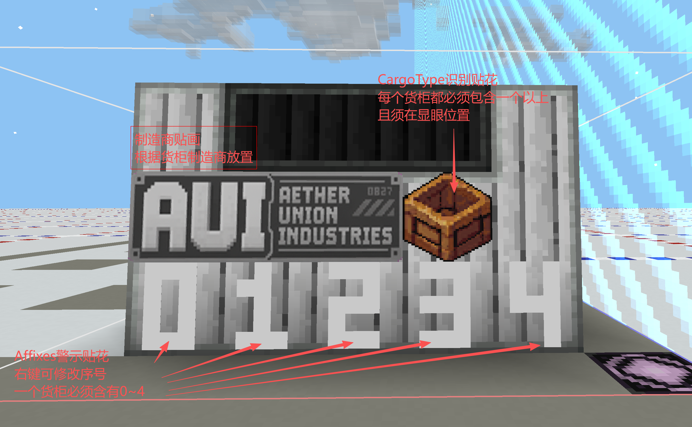
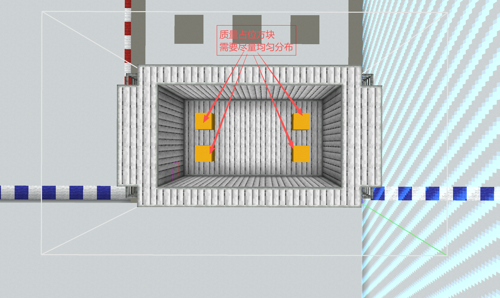

# 货柜结构制作规范

本文规定货柜结构模板的最低制作要求。所有正式货柜在保存为 `.nbt` 前都应完成本页检查。

实现原理和模板路径参见[货柜结构模板](03_货柜结构模板.md)。本期 45 款实际结构已接入，规格、包络及接口见[实际模板分配表](../../10数据包定义与模板/03_货柜/模板重分配与搭建清单.md)。

## 一、强制要求

### 1. 货物图案模板占位

每个货柜结构必须包含至少一个货物图案模板占位。

- 模板中的 `cargo_type_decal_marker` 显示问号图案，首次生成时转成 `cargo_artwork_display_anchor`，空柜透明；实际装载使用物品属性声明的 decal，世界实体和预览读取冻结快照。该图案不再由 CargoClass 决定；模板占位 ID 保持不变。
- 占位贴花应放在玩家容易观察的位置。
- 放置多个占位贴花时，应确认各个朝向均能正确显示。
- 不要直接把固定货物图案保存进通用货柜模板。

### 2. 运输条件模板占位

使用 `cargoverse:affix_decal_marker`，按需要布置 `slot=0～15`，编辑时可直接看到编号。主手右键循环编号，动作栏同时提示；同侧使用不同序号，不同侧可重复。首次生成时保持朝向、尺寸和编号转成 `cargo_condition_display_anchor`；编号按冻结条件 ID 排序，空位保留运行时锚点并透明显示。不再限制货物只有五项条件。

- 从冻结运输条件取图，不从 GUI 合并文本或货柜能力推测。
- 主手右键选择编号，扳手切换 1x1／2x2／3x3；装配后布局不可编辑。
- 槽位不足只影响显示，制作时应结合系列职责补位，不能据显示数量减少运输条件。
- 空展示位同样进入物理方块集合；不要在模板导出前删成空气。
- 模板只放编辑占位，不从已生成货柜复制运行时锚点；装卸刷新只更新运行时图案，不反复替换模板占位。



### 3. 质量占位方块

每个货柜结构必须包含一个或更多质量占位方块。

- 系统先计算不含已分配补充质量的结构基线，再按 max(结构质量, 定义空重)＋货物质量补足。保留方块及其质量数据；重复刷新相同值不清零、不重新发布物理质量。
- 存在多个质量占位方块时，补充质量按 double 精度平分，最后一块吸收浮点尾差，不逐块向上取整。
- 质量占位方块应尽量分布在结构内部或受保护位置，不应影响外观和运输接口。
- 不要使用旧压载占位块代替质量占位方块。
- 模板没有质量锚点时拒绝生成。锚点位置与实例绑定一起持久化；装卸后在原位置更新质量，不重新从模板推测。


### 4. 货柜等级与尺寸

size_class 是货柜定义的显式规格。模板真实包络仍按 X×Y×Z 记录，但不由体积自动改写规格；旧文档的两套分档体积阈值不再作为本轮强制门槛。

当前 Atlas 占位包络仅作尺度参照：S 7×3×5、M 9×4×6、L 13×6×6、X 15×8×9、XL 17×8×9（临时扩展）。系列可以采用不同长宽高，最终需由制作人确认占地和装卸通道，并在游戏中检查四向生成、碰撞和接口可达性。

不要为凑规格在边界添加无意义方块或空气。容量不按内腔自动计算；空重不得低于实际结构质量下限。

### 5. 可运输性

货柜结构必须在设计阶段考虑实际运输方式。

- 明确型号接口约定（LC／LM／SD／MC／SI／HD）及实际使用的连接方块，不能把接口代号当成程序功能。
- 为对接器、绑扎点、吊装点或承载面预留足够空间。
- 检查结构重心、底面和外轮廓，避免正常运输时明显失衡。
- 货柜不应只能依靠临时方块或破坏结构才能装卸。
- 外露装饰不得妨碍载具、锁定器、绳索或周边货柜。
- 大型规格应验证转弯、停靠、装卸和成组摆放所需空间。

### 6. 可用方块范围

货柜结构只能使用：

- Minecraft 原版方块；
- CargoVerse 本模组方块；
- CargoVerse 声明为必须依赖的模组所提供的方块。

不得使用可选模组、整合包临时模组、开发工具模组或其他非必须依赖提供的方块。否则缺少对应模组时可能导致模板无法加载、方块丢失或存档损坏。

### 7. 实体与方块实体边界

货柜模板不应包含实体，也应尽量避免业务库存等 BlockEntity 方块。模板展示占位是普通静态贴花，没有方块实体；运行时展示锚点由首次生成创建，不应复制到模板。质量锚点是必要的方块实体例外，没有持续 Ticker；导出模板前清除实例绑定和运行缓存，生成时会重新绑定。

禁止保存：

- 生物、盔甲架、展示实体、掉落物、载具等实体；
- 物品展示框、画等附着实体；
- 模板中意外捕获的玩家、船、矿车或模组实体；
- 实体乘客关系、实体 UUID 或其他实体 NBT；
- 装有物品或流体的容器；
- 保存了运行状态、所有者、网络地址或外部 UUID 的方块实体。

导出结构时必须关闭“包含实体”或使用等效设置。

若外观必须依赖某种 BlockEntity 方块，应先确认它不会持续 Tick、不会保存敏感运行状态，并经过专门测试。

### 8. 质量控制

货柜主体应尽量使用低质量方块，让质量占位系统有足够空间补足目标质量。

- 结构实际质量是目标质量无法突破的下限。
- 如果模板实际质量高于数据定义计算出的目标质量，最终仍会使用结构实际质量。
- 避免大量使用高密度装饰块、隐藏压载块或质量异常的模组方块。
- 调整结构材料后应重新实测结构质量，不能沿用旧结果。

### 9. 避免可交互方块

货柜结构应尽量避免可互动、可储存或会主动更新的方块，以减少漏洞和额外开销。

尽量不要使用：

- 箱子、桶、储罐和其他容器；
- 门、活板门、按钮、拉杆等可切换状态方块；
- 工作站、菜单方块和机器；
- 红石元件、命令方块、结构方块和拼图方块；
- 会随机 Tick、生长、融化或扩散的方块；
- 火、传送门、流体源和持续产生粒子的复杂方块；
- 具有持续服务端 Tick 或网络同步行为的模组方块。

货柜实例虽然具有编辑保护，但模板本身仍应采用最小攻击面设计，不能只依赖事件拦截保证安全。

## 二、推荐规范

### 1. 原点与底面

- 货柜生成原点是模板底面中心点。
- 模板底面应平整，并明确实际承载面。
- 不要在底面以下保存无关方块。
- 保存前清理模板边界，避免无意义空气范围扩大外接包围盒。

### 2. 贴花布局

- 贴花应紧贴安装表面，避免与主体严重穿插或悬空。
- 为货物图案与按需配置的运输条件槽位预留稳定位置，不要让其他装饰遮挡。
- 检查四个水平方向下的贴花朝向。
- 普通贴花缩放后不得超出预期表面或侵入运输接口。

### 3. 结构稳定性

- 避免依赖邻居更新才能保持状态的方块。
- 避免只靠易碎装饰连接主体的视觉结构。
- 不要保存正在运动、正在组装或尚未稳定的模组结构状态。
- 不要在模板中保留结构方块、测试标记和临时辅助方块。

### 4. 性能

- 优先使用静态普通方块。
- 控制透明、动态渲染和复杂模型方块的数量。
- 避免持续发光、发声、产生粒子或进行环境扫描的方块。
- 相同视觉效果优先通过方块状态、静态模型和贴花实现。

### 5. 命名

- 结构文件名使用小写英文、数字和下划线。
- 模板 ID 应与货柜定义中的 `template` 完全一致。
- 推荐按制造商、系列、接口和规格组织路径。

示例：

```text
cargoverse:cargo/aui/atlas/aui_atlas_sd_s
```

## 三、保存前检查

### 必备内容

- [ ] 包含至少一个货物图案模板占位，未误放运行时锚点
- [ ] 按需包含编号 `0`～`15` 的运输条件模板占位，未误放运行时锚点
- [ ] 包含至少一个质量占位方块
- [ ] 已记录显式规格、真实包络和预计装卸空间；不靠体积自动分档
- [ ] 运输接口、底面和装卸空间明确

### 内容安全

- [ ] 只使用原版、本模组和必须依赖模组的方块
- [ ] 未保存任何实体
- [ ] 未保存容器内容、流体或敏感方块实体数据
- [ ] 没有结构方块、拼图方块或临时制作方块残留
- [ ] 没有不必要的可交互、随机 Tick 或持续 Tick 方块

### 物理与表现

- [ ] 模板实际质量低于或符合目标质量范围
- [ ] 质量占位方块不会破坏外观和运输结构
- [ ] 贴花位置、朝向和缩放正确
- [ ] 四个水平方向放置时外观正常
- [ ] 模板底面中心与预期生成原点一致

### 游戏内验证

- [ ] 可以由大型货柜制造台正常生成
- [ ] 可以通过 `/cargoverse summon` 生成
- [ ] 编辑时编号可见，首次生成后空位透明；装卸只更新运行时图案，预览与世界一致
- [ ] 实际质量与 GUI、HUD 显示一致
- [ ] 存档重载后质量、碰撞和位置保持正确
- [ ] 普通玩家无法编辑、交互或向货柜放置流体
- [ ] 货柜能够按预定方式装载、固定、移动和卸载

[返回货柜系统](../README.md)
