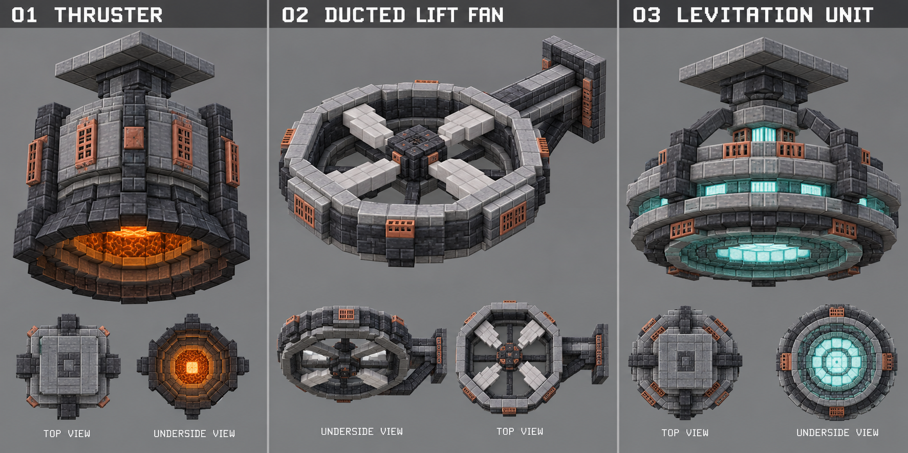
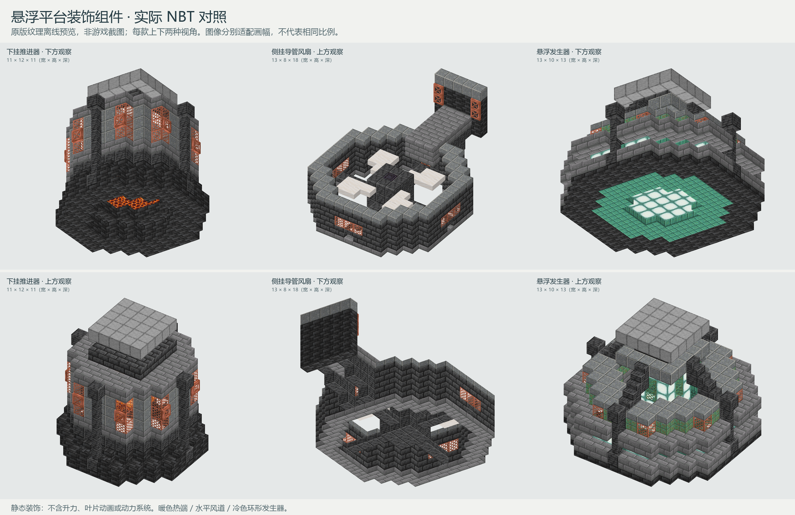
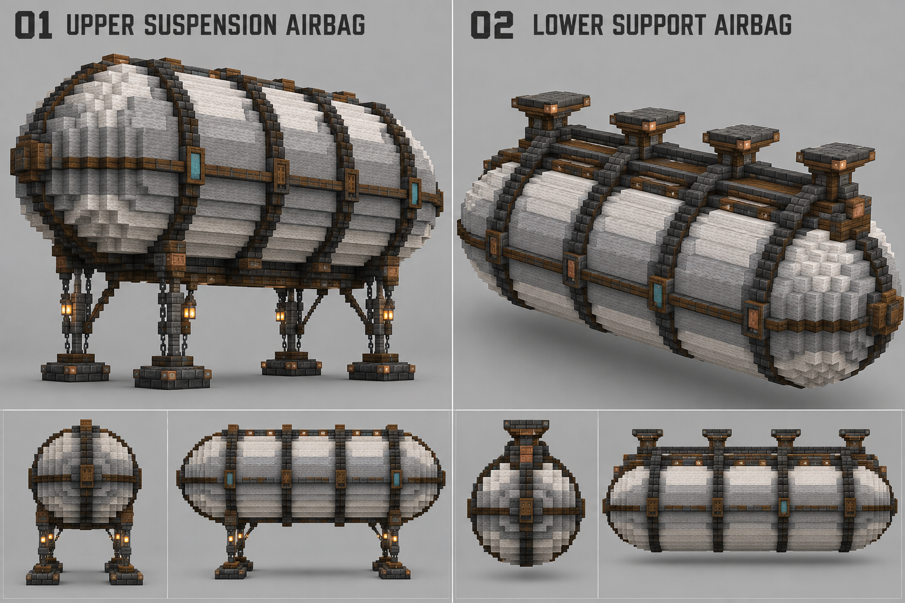
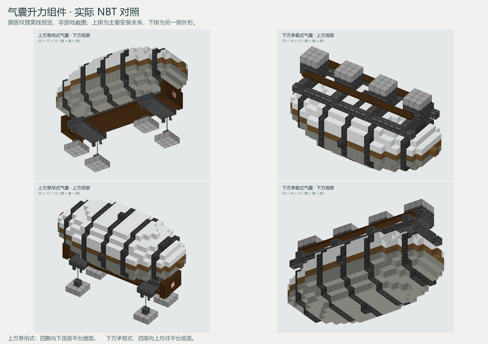
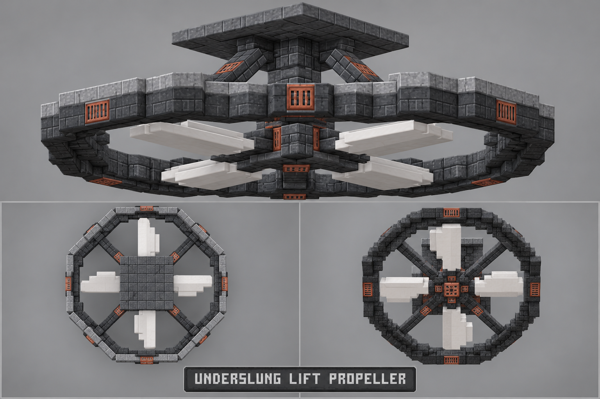
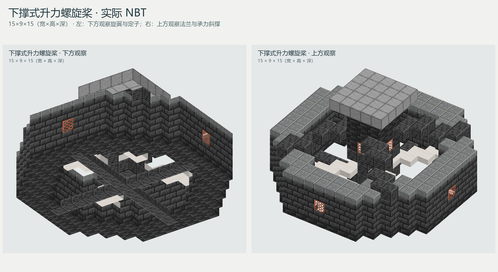

# 悬浮平台装饰组件

首批提供下挂推进器、侧挂导管风扇、悬浮发生器各一款，作为悬浮平台的外观解释与拼装试样。三款采用统一的灰石材、深板岩与局部铜质机械语言，暂不分制造商。它们是静态装饰，不提供升力、旋转动画或运行逻辑。

## 统一概念参考

参考板由内置图片生成功能生成，[完整提示词](../../../../assets/images/trade_points/common/platform_lift/concept_prompt.txt)随图保留。各款主视图确定轮廓，小视图辅助判断喷口、叶片和安装接口；不将材质砖缝和发光描边当成额外几层方块。

## 尺度与形体落实

以顶端约 5×5 的安装法兰、约 3×3 的颈部／轮毂为局部基准。推进器采用约 11 格口径、12 格高度；风扇环体约 13 格口径，加上后侧支臂与法兰约 18 格纵深；发生器环体约 13 格口径，双环、核心与吊颈分层约 10 格高。原版方块形成阶梯八角轮廓，不追逐图片中无法按方块复现的斜切面或细密零件。

| 组件 | 关键轮廓与安装关系 | 原版材料对应 |
| --- | --- | --- |
| 下挂推进器 | 顶部法兰、短颈、灰色机体、四向加强肋、向下扩口喷嘴；热端退入喷口内部 | 磨制安山岩、平滑石、石砖；深板岩砖／瓦、楼梯／台阶／墙；涂蜡铜格栅／活板门；岩浆块与菌光体 |
| 侧挂导管风扇 | 水平环形导管、四片同向旋转排布的叶片、中央轮毂与下层定子；后伸支臂连接竖向法兰 | 深板岩砖与瓦、石砖／磨制安山岩压边；平滑石英台阶叶片；涂蜡铜检修面板 |
| 悬浮发生器 | 顶法兰与颈部连接四向支架；双层环形外壳、冷色核心及内凹下表面 | 石砖、磨制安山岩、深板岩细构件；涂蜡锈蚀铜与铜格栅；海晶石与海晶灯 |

风扇轴线为竖直方向，风道朝下；“侧挂”指设备通过支臂安装在平台边缘。推进器与发生器安装在平台底面。发光块属于内置热端／发射面，支架和安装颈保持连续。

## 首批交付

2026-10-01 提供三份独立 NBT，采用原版 1.21.1 方块。尺寸顺序为 **X×Y×Z（宽×高×深）**，包含全部支架和安装法兰。三款均未分配制造商品牌，供现场比较后选用。

| 组件 | 加载名称 | 尺寸 |
| --- | --- | --- |
| 下挂推进器 | `cargoverse:common/platform_lift/underslung_thruster_01` | 11×12×11 |
| 侧挂导管风扇 | `cargoverse:common/platform_lift/side_ducted_fan_01` | 13×8×18 |
| 悬浮发生器 | `cargoverse:common/platform_lift/levitation_generator_01` | 13×10×13 |

结构资源目录为 `generated/cargoverse/structures/common/platform_lift/`，其中仅交付三份 `.nbt`。不包含平台主体、额外测试场地、实体或运行设备；不会改变既有贸易点。

## 实际结构预览

以上为交付 NBT 使用原版方块模型与纹理生成的离线预览，非游戏截图，也不是再次生成的概念图。每款提供上下两种视角，分别适配画幅，不按同一比例展示。照明、阴影、纹理过滤和半透明表现以游戏内为准。

| 组件 | 主视图 | 另一侧视图 |
| --- | --- | --- |
| 下挂推进器 | [下方喷口](../../../../assets/images/trade_points/common/platform_lift/underslung_thruster_01_main.png) | [顶部安装颈](../../../../assets/images/trade_points/common/platform_lift/underslung_thruster_01_reverse.png) |
| 侧挂导管风扇 | [叶片与侧臂](../../../../assets/images/trade_points/common/platform_lift/side_ducted_fan_01_main.png) | [底部定子支撑](../../../../assets/images/trade_points/common/platform_lift/side_ducted_fan_01_reverse.png) |
| 悬浮发生器 | [下方发射盘](../../../../assets/images/trade_points/common/platform_lift/levitation_generator_01_main.png) | [核心与径向支架](../../../../assets/images/trade_points/common/platform_lift/levitation_generator_01_reverse.png) |

## 安装关系

以下均为模板未旋转时的局部方块坐标，以包围盒最小角为 `(0,0,0)`；放置原点需包含结构方块的加载偏移。

| 组件 | 安装法兰范围（含两端） | 与平台相接的位置 |
| --- | --- | --- |
| 下挂推进器 | `(3,11,3)` → `(7,11,7)`，5×5 水平面 | 平台底层位于局部 `Y=12`，法兰上表面贴合平台底面 |
| 侧挂导管风扇 | `(4,3,17)` → `(8,7,17)`，5×5 竖直面 | 平台边缘在局部 `Z=18`，设备向 `-Z` 伸出；保留风扇上下方开放空间 |
| 悬浮发生器 | `(4,9,4)` → `(8,9,8)`，5×5 水平面 | 平台底层位于局部 `Y=10`，法兰上表面贴合平台底面 |

顶部法兰采用完整方块，直接贴合平台时不留半格缝。风扇的下层十字为定子支撑，上层四片为静态叶片，两层有明确高差。支架之外的环间空隙和喷口内凹均为有意设计。

模板包含空气以保持喷口、风道和环间空间。安装时按上述接触面从平台外侧贴合，避免把整个包围盒嵌入现有平台。三款只表达悬浮原理的外观，最终选型及游戏内使用效果待现场确认。

## 气囊组件

第二批增加两种气囊安装逻辑。一张参考板同时确定两者的气囊比例、分段肋带和安装基准，避免不同图片产生不一致的外形。

参考板由内置图片生成功能生成，[完整提示词](../../../../assets/images/trade_points/common/platform_lift/airbag_concept_prompt.txt)随图保留。实际搭建采用 25 格长的阶梯椭球，以 3×3 安装座作为尺度基准；省略参考图中过密的活板门饰条和会干扰气囊轮廓的细小挂件。

| 组件 | 加载名称 | 尺寸 | 接口逻辑 |
| --- | --- | --- | --- |
| 上方悬吊式气囊 | `cargoverse:common/platform_lift/upper_suspension_airbag_01` | 25×17×13 | 气囊在平台上方；连续下龙骨通过四组吊架连接四个同标高的底部安装脚 |
| 下方承载式气囊 | `cargoverse:common/platform_lift/lower_support_airbag_01` | 25×14×13 | 气囊在平台下方；双纵梁和四道横向鞍架连接四个同标高的顶部承载座 |

气囊主体使用白色、浅灰色羊毛表达分片蒙皮，深板岩瓦形成五道外部加强肋，云杉木形成中部环带；少量青色陶瓦只作为识别片。所有肋带只替换气囊表面方块，不贯穿内部，也不会切断蒙皮。

### 实际结构预览

| 组件 | 主要安装视图 | 另一侧视图 |
| --- | --- | --- |
| 上方悬吊式气囊 | [下龙骨、吊架和四脚](../../../../assets/images/trade_points/common/platform_lift/upper_suspension_airbag_01_main.png) | [顶部气囊轮廓](../../../../assets/images/trade_points/common/platform_lift/upper_suspension_airbag_01_reverse.png) |
| 下方承载式气囊 | [顶部纵梁、鞍架和四座](../../../../assets/images/trade_points/common/platform_lift/lower_support_airbag_01_main.png) | [下方气囊轮廓](../../../../assets/images/trade_points/common/platform_lift/lower_support_airbag_01_reverse.png) |

上方悬吊式的四个底部安装面为 `(4,0,2)→(6,0,4)`、`(4,0,8)→(6,0,10)`、`(18,0,2)→(20,0,4)`、`(18,0,8)→(20,0,10)`；平台屋面紧贴局部 `Y=-1`。下方承载式的四个顶部安装面分别以 `X=3、9、15、21` 为中心，范围均为中心左右一格、`Y=13`、`Z=5→7`；平台底层位于局部 `Y=14`。

两款均为静态装饰，不含浮力、绳索摆动或受力计算。模板包含空气以维持吊架间距和鞍架空隙，安装时应从平台外侧对齐安装面。

## 下撑式升力螺旋桨

当平台侧面没有足够空间安装导管风扇时，可改用中央下撑式结构。它将法兰、承力颈、旋翼和保护环全部放在平台底面以内，不占用侧立面接口。

概念参考由内置图片生成功能生成，[完整提示词](../../../../assets/images/trade_points/common/platform_lift/underslung_propeller_concept_prompt.txt)随图保留。落地时保留 5×5 顶法兰、中央承力颈、四组斜撑、15 格八角保护环、四片旋翼和下层十字定子；省略图中无法在该尺度稳定复现的细密斜面。

| 项目 | 内容 |
| --- | --- |
| 加载名称 | `cargoverse:common/platform_lift/underslung_lift_propeller_01` |
| 尺寸 | 15×9×15（宽×高×深） |
| 顶部安装面 | `(5,8,5)→(9,8,9)`，完整 5×5 法兰 |
| 平台位置 | 平台底层位于局部 `Y=9`，法兰上表面贴合平台底面 |
| 气流方向 | 旋翼轴竖直，向下排风；保护环上下保持开放 |

实际模板使用深板岩砖／瓦形成保护环和轮毂，磨制安山岩形成上沿，平滑石英台阶形成四片同轴旋翼，涂蜡铜格栅作为少量检修面板。旋翼由同一组局部坐标旋转生成，四片保持一致；顶法兰采用完整方块，不产生半砖安装缝。

这是静态装饰结构，不含旋转动画、伤害判定或实际升力。模板包含空气以保持旋翼净空，安装时从平台下方贴合法兰，不应将保护环包围盒嵌入楼板。
