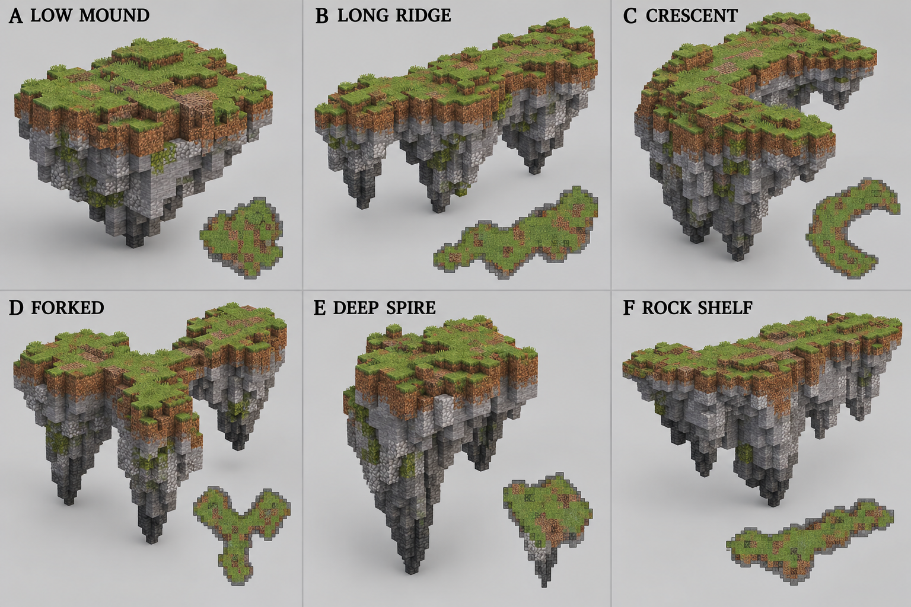
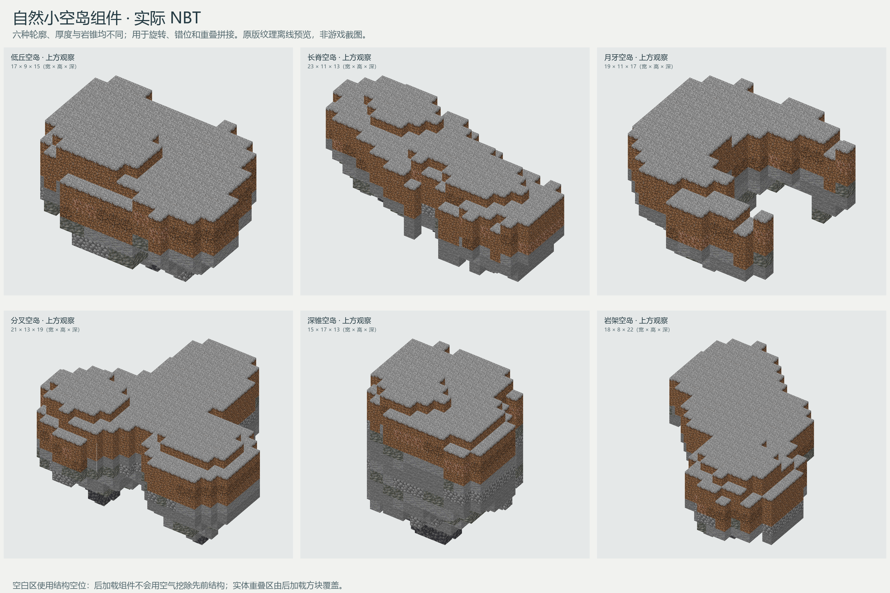

# 自然空岛组件

新增[硬朗岩柱底座](02_硬朗岩柱底座.md)：直接参考浮岛截图，以单一石材、大块垂直断面和错落岩脚组成三款主体与一款薄边，单独交付于 `foundations_angular/`，用于与平缓版比较。

2026-10-02 新增[建筑底部岩块](01_建筑底部岩块.md)：三款约 32 格的主体岩块及一款薄边岩块，采用平缓接触面、宽缓底部和连续石质斑块，适合在现有贸易点下方反复重叠布置。以下为首批六款小空岛的记录。

本组结构提供六种没有标准接口的自然小空岛，用于旋转、错位、调整标高并相互重叠，组合成任意大小和轮廓的空岛。各结构的水平尺寸、厚度、表面台阶、岩锥位置和重心都不同，不采用统一网格、对称外形或固定拼接边。

## 概念参考

参考图由内置图片生成功能生成，[完整提示词](../../../../assets/images/trade_points/common/floating_islands/concept_prompt.txt)随图保留。实际结构继承低丘、长脊、月牙、分叉、深锥和岩架六种轮廓，不将图中的草纹、石缝或偶然突出块逐项当作固定构件。

## 交付结构

尺寸顺序为 **X×Y×Z（宽×高×深）**。所有方块均来自原版 Minecraft Java 1.21.1。

| 组件 | 加载名称 | 尺寸 | 适合用途 |
| --- | --- | --- | --- |
| 低丘空岛 | `cargoverse:common/floating_islands/island_low_mound_01` | 17×9×15 | 填补主岛缺口、加宽局部地面 |
| 长脊空岛 | `cargoverse:common/floating_islands/island_long_ridge_01` | 23×11×13 | 延长岛体、形成偏斜山脊 |
| 月牙空岛 | `cargoverse:common/floating_islands/island_crescent_01` | 19×11×17 | 制造凹湾、缺口或环形边缘 |
| 分叉空岛 | `cargoverse:common/floating_islands/island_forked_01` | 21×13×19 | 从主岛分出两个不等宽支岔 |
| 深锥空岛 | `cargoverse:common/floating_islands/island_deep_spire_01` | 15×17×13 | 形成较厚核心和明显下垂岩锥 |
| 岩架空岛 | `cargoverse:common/floating_islands/island_rock_shelf_01` | 18×8×22 | 扩展薄平台、悬崖和外伸岩架 |

## 实际结构预览

这是交付 NBT 使用原版方块模型生成的离线预览，非游戏截图。预览器没有应用生物群系草方块染色，因此草面显示为灰色；游戏内会按所在生物群系显示正常草色。

各岛采用草方块表面，泥土、砂土和缠根泥土形成上层，石头、安山岩、凝灰岩及少量圆石形成下层；最深岩锥混入纵向深板岩与深板岩圆石。材料斑块由各结构的独立固定种子生成，形状可重复加载，但六种结构不会共享同一分布。

## 拼接方式

这些结构通过覆盖拼接，不要求边缘相接：

1. 先放置深锥、分叉或长脊作为主要体量。
2. 将其他组件旋转 90°、180° 或 270°，水平错开后让实体范围互相重叠数格。
3. 根据希望的坡度上下错开一至两格；需要连续平地时，让较高组件的草面覆盖较低组件边缘。
4. 用低丘填补明显凹口，用月牙保留有意的内湾，用岩架向外扩展薄边。
5. 最后在游戏内修整重叠处的草面、陡坎和材料过渡。

NBT 的空白区域使用 `minecraft:structure_void`，后加载的组件不会用空气挖除先放置的岛体；只有实际泥土与岩石方块会覆盖重叠位置。这个行为允许组件包围盒交叉，也是本组结构自然拼接的基础。

首批在本组结构目录交付六份 `.nbt`，不包含组合示例、清单、备份或说明文件；新增建筑底部岩块单独放在 `foundations/` 子目录。组件不带植被、树木、水体和建筑，便于拼接完成后按具体场景继续布置。
