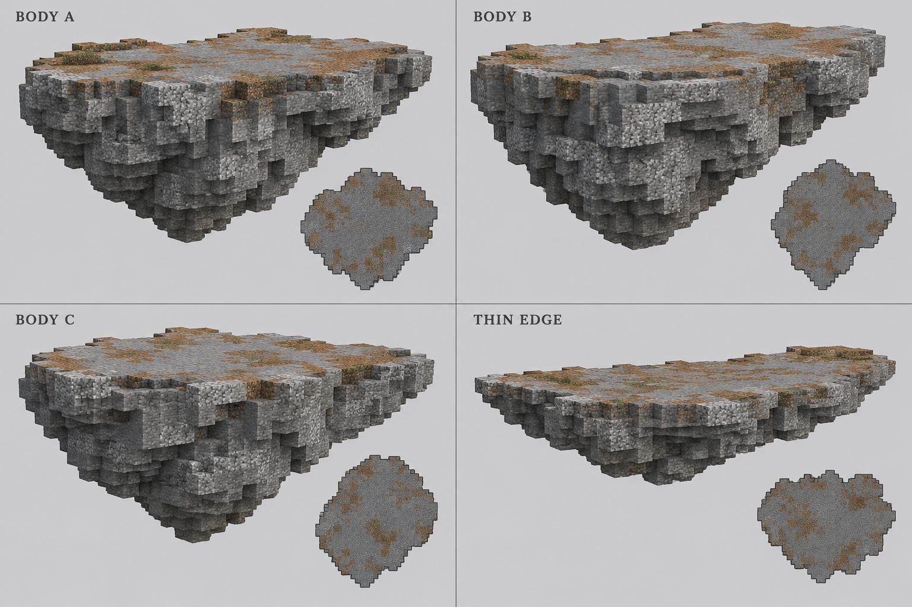
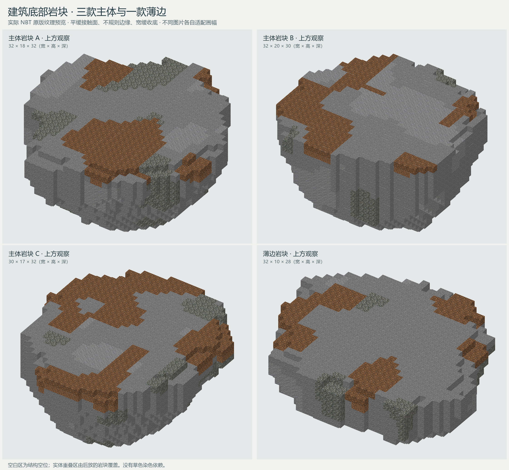
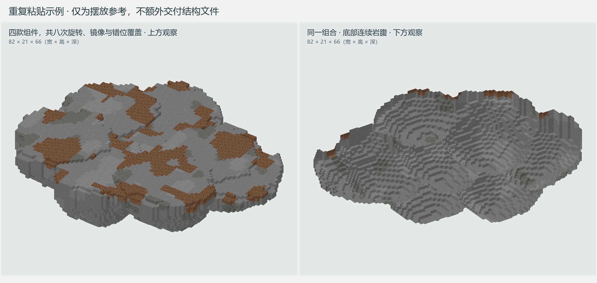

# 建筑底部岩块

本页记录平缓收底版。后续根据浮岛截图制作的[硬朗岩柱底座](02_硬朗岩柱底座.md)采用垂直断面、不等长岩脚与单一石材，在独立目录中交付，便于比较选用。

本组用于将贸易点主体承托为浮空版本：三款约 32 格的主体岩块，加一款薄边岩块，分别旋转、错位和重叠布置在地基下方。没有固定接口，顶部提供宽阔的近似平面，外缘与底部保留自然的不对称收束。

## 统一参考

参考板由内置图片生成功能生成，[完整提示词](../../../../assets/images/trade_points/common/floating_islands/foundations/concept_prompt.txt)随图保存。四件采用同一套浅灰地质材质，区别集中在重心、厚度和底部坡度，避免尖锥、洞口、分叉、晶体等容易暴露重复的特征。

以主视图与俯视小图共同确定宽厚比例；单件水平约 30～32 格，主体厚约 17～20 格、薄边约 10 格。图中小石缝和密集斑点按纹理理解，落地使用连片安山岩、少量凝灰岩和浅层土块，不逐格随机替换材料。

主体顶面以石头为主，少量土块形成浅表斑块。中央接触面平缓，边缘允许下降一格；下方以宽缓岩腹与低起伏台阶相接，最深处为钝面。薄边岩块向一侧逐渐变薄，便于将主岛边缘过渡到外伸平台。

## 交付记录

2026-10-02 交付四份独立 NBT，原版 Minecraft Java 1.21.1 方块。尺寸顺序为 **X×Y×Z（宽×高×深）**。

| 组件 | 加载名称 | 尺寸 | 顶面基准 Y |
| --- | --- | --- | --- |
| 主体岩块 A | `cargoverse:common/floating_islands/foundations/rock_body_01` | 32×18×32 | 17 |
| 主体岩块 B | `cargoverse:common/floating_islands/foundations/rock_body_02` | 32×20×30 | 19 |
| 主体岩块 C | `cargoverse:common/floating_islands/foundations/rock_body_03` | 30×17×32 | 16 |
| 薄边岩块 | `cargoverse:common/floating_islands/foundations/rock_edge_01` | 32×10×28 | 9 |

文件位于结构资源目录 `generated/cargoverse/structures/common/floating_islands/foundations/`，本组目录仅含以上四份 `.nbt`。概念图、提示词与预览放在文档资源目录；组合示例仅提供图片。

## 实际结构预览

以上直接使用交付 NBT 和原版材质离线渲染，非游戏截图。主体以石头为主，安山岩和凝灰岩按连续三维斑块混合；顶部少量砂土与泥土为浅层覆盖。四款都没有植被、矿物、深黑底尖或独立装饰。每款的轮廓和材质固定，随机性来自轮换款式、旋转、镜像与位置变化。

## 重复粘贴示例

图中四款共放置八次，主体各两次、薄边两次，采用不同旋转、镜像和一至两格高差；合成岩体的实际包围盒为 82×21×66。左侧显示顶面与外缘，右侧显示同一组合的底部。组合仍保留部分接缝台阶，供现场按建筑地基和希望的坡度修整。

### 贴合建筑

将岩块的最高面接到地基底面。若地基最底层方块坐标为 `Y=G`，模板包围盒原点可设为 `G−模板高度`，这样岩块最高方块位于 `G−1`。结构方块自身的加载偏移需计入原点；上表的顶面基准为未旋转模板局部坐标。水平旋转和镜像不改变顶面高度。

主体相邻覆盖约 8～14 格可作为起点，实际按建筑轮廓错位摆放，不必排成规则行列。先用三款主体覆盖较大的地基，再用薄边补外围和较窄的外伸部分。需要岩腹错层时可将部分组件下移一至两格；贴合建筑的上限仍由地基底面控制。

空白区写入 `minecraft:structure_void`，按结构模板方式加载时不以空气清除已放置的岛体。实际石土仍会覆盖接触位置已有方块，因此岩块应布置在地基以下；结构空位本身不提供建筑保护。使用其他建筑工具再次复制时，按该工具的空白处理与目标范围规则进行拼接。
