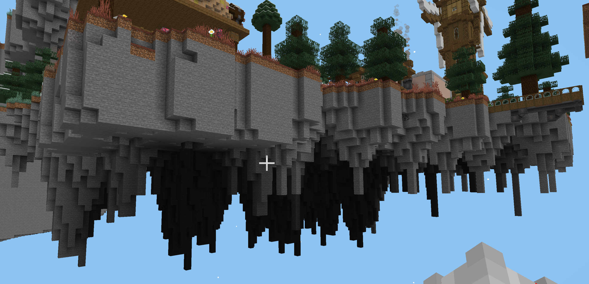
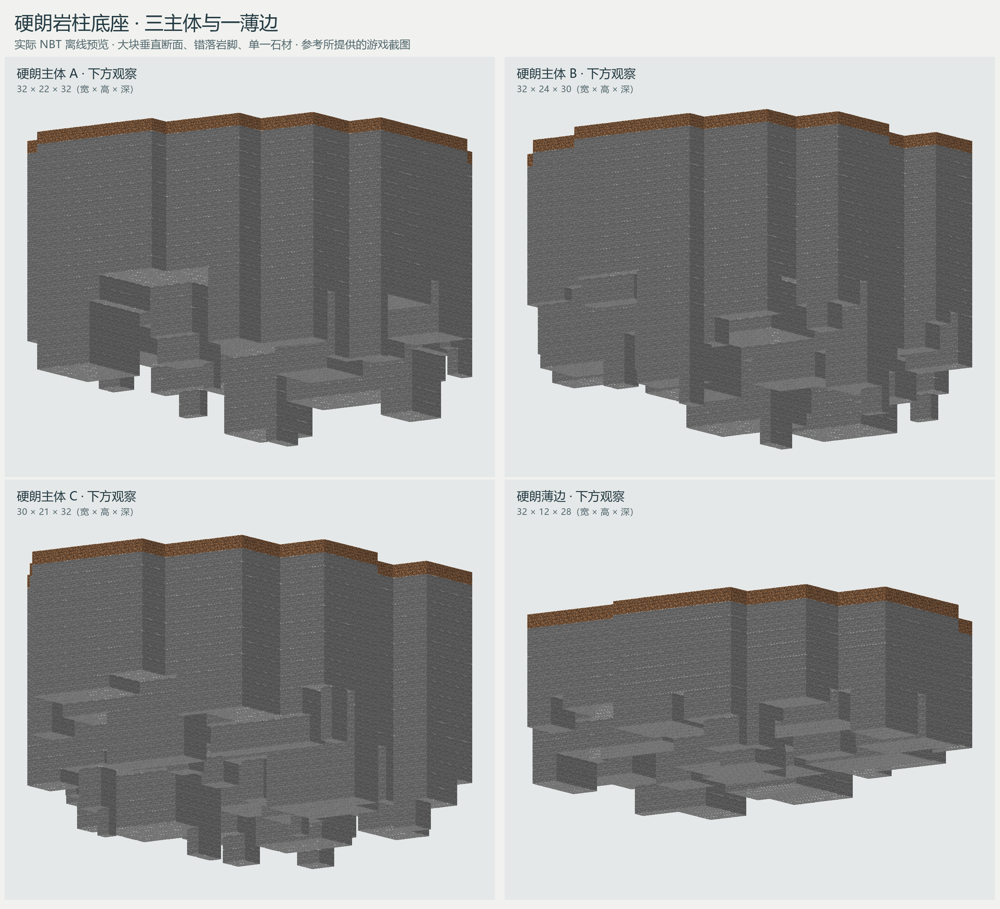
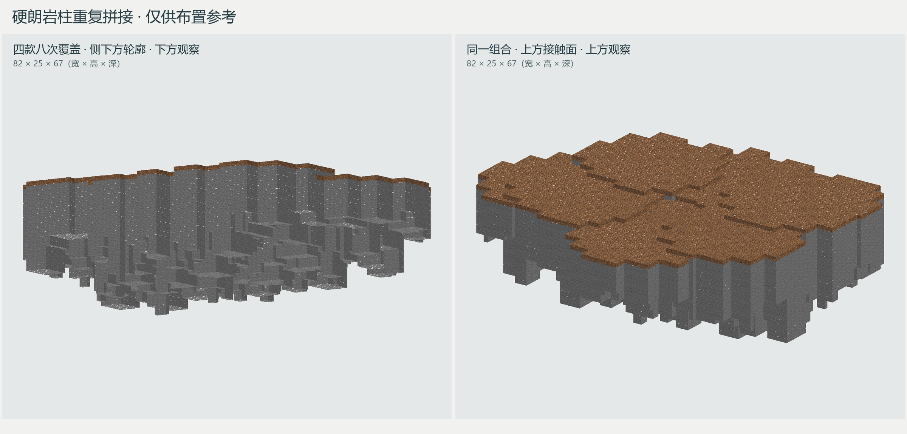

# 硬朗岩柱底座

本版直接根据提供的浮岛截图制作，提供三款主体岩块和一款薄边岩块。整体依靠宽阔垂直断面、侧面一至两格凹凸、不等长岩柱和底部短岩脚形成变化；没有同心轮廓式的平滑收底，也不靠材质斑点表达细节。

## 外形参考

截图中的岩体是本版形态依据，建筑、植被与其他设施不属于本组组件。图中近侧岩壁表现为连续的大块石面，下方岩柱高低交错，局部只有一次或两次横截面缩进。远侧较细的岩脚仍直接接在岛体上，不单独悬空。

横向尺度沿用约 32 格组件，主体高度约 21～24 格，薄边高度约 12 格。各片岩壁按约 4～9 格的不等宽段落组合，底部缩进后延长二至五格，局部增加短齿；不同段落不等长、不等距。该尺寸是小组件化后的设计值，并非从截图测得整座岛的尺寸。

岩体统一使用石头，顶面铺一层泥土。顶部保持平坦以贴合建筑地基，侧面和底部通过几何变化形成明暗。图中较暗的底部理解为遮光效果，不用黑色方块涂成阴影。所有空白位置使用结构空位，以支持实体重叠。

## 交付记录

2026-10-02 提供四份原版 Minecraft Java 1.21.1 NBT。尺寸顺序为 **X×Y×Z（宽×高×深）**。

| 组件 | 加载名称 | 尺寸 | 顶面 Y |
| --- | --- | --- | --- |
| 硬朗主体 A | `cargoverse:common/floating_islands/foundations_angular/rock_body_01` | 32×22×32 | 21 |
| 硬朗主体 B | `cargoverse:common/floating_islands/foundations_angular/rock_body_02` | 32×24×30 | 23 |
| 硬朗主体 C | `cargoverse:common/floating_islands/foundations_angular/rock_body_03` | 30×21×32 | 20 |
| 硬朗薄边 | `cargoverse:common/floating_islands/foundations_angular/rock_edge_01` | 32×12×28 | 11 |

这四个名称对应硬朗版；较平缓的前一版仍见[建筑底部岩块](01_建筑底部岩块.md)。本组独立结构目录 `generated/cargoverse/structures/common/floating_islands/foundations_angular/` 中仅交付四份 `.nbt`。

## 实际外观

预览直接读取交付 NBT，以原版纹理离线渲染，非游戏截图。采用较低机位以展示垂直断面和错落岩脚，照明未模拟游戏中的完整环境遮蔽；实际游戏内的背光区域会有不同明暗。各图按画幅适配，不代表相同比例。

## 多次重叠效果

图中四款各使用两次，共八次放置，结合水平旋转、镜像与一至两格高差，合成范围为 82×25×67。左侧展示侧下方轮廓，右侧为同一组合的顶部。示例仅为预览，不在存档中增加组合结构文件。

拼接时可先使主体重叠约 8～14 格，再用薄边处理外伸平台。岩体顶部与地基底面相接：地基最底层方块为 `Y=G` 时，模板原点可取 `G−模板高度`。各模板局部原点均为包围盒最小角，结构方块的加载偏移需另行计入。

空白使用 `minecraft:structure_void`，结构模板加载时跳过这些位置；实际石土仍会覆盖重叠位置已有方块。布置范围应限制在地基以下，接缝和泥土标高按现场修整。原版结构加载之外的复制工具需按自身规则处理空白和目标范围。
